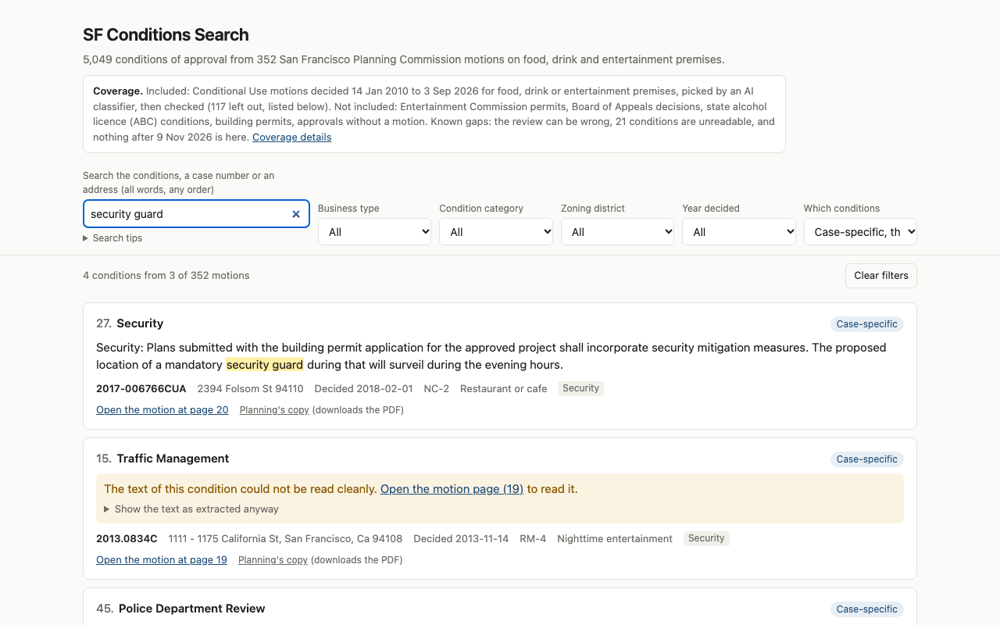
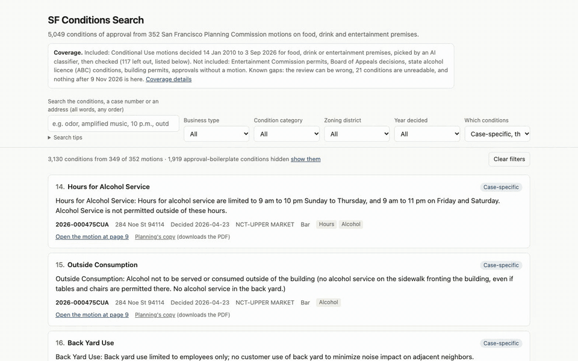
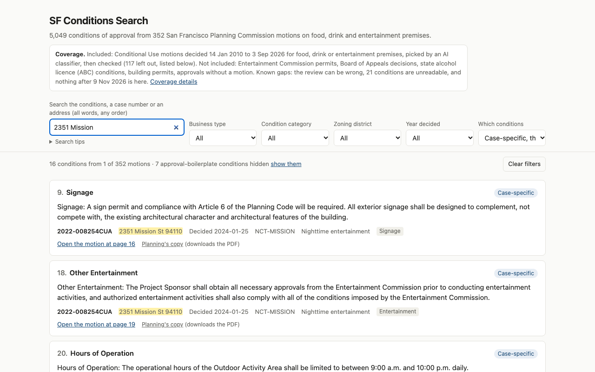

# sf-hospitality-permits

Open tools for finding out what a bar, restaurant, cafe or entertainment venue needs from the City of San
Francisco before it can open at a given address, built only from public records.

<!-- SPDX-License-Identifier: AGPL-3.0-only -->

The repository holds three things:

1. **SF Conditions Search**, a public, read-only search over every condition of approval in the San Francisco
   Planning Commission's Conditional Use motions on food, drink and entertainment premises decided from January
   2010 on: 5,049 conditions from 352 motions (motions decided 14 Jan 2010 to 3 Sep 2026). Each result links to
   the adopted motion at the page where the condition starts. Live at **https://sf-conditions-search.vercel.app**.
   Every result card has a "Wrong or missing? Tell me" e-mail link, and page views are counted by Vercel Web
   Analytics without cookies (see [The conditions search](#the-conditions-search)).
2. **A rules engine** that reads the San Francisco Planning Code controls and the public record for an address
   and a plain-English business description, and sets a status for each approval the concept needs (zoning and
   use, alcohol, entertainment, health, building and change of use, outdoor), with the rules applied, the facts
   they read, and what is not known.
3. **A memo app** (web app plus API) that turns the engine's output into a "Location Risk Memo": one row per
   approval, the records on file at the address, comparable cases nearby, and the questions that would settle
   what the records cannot. The app's working name in this repository is **Permit Memo**, a placeholder set in one
   place for the web app (`apps/web/src/lib/brand.ts`) and one for the API (`APP_NAME`, `apps/api/app/core/config.py`).







> Nothing here is legal advice. The memo is in testing: checked against past cases, it missed important issues
> in more than half of new cases (see [Validation](#validation)). Use it as a starting point, not a conclusion.

## How it works

### The memo: sources → ingest → rules → memo

```
public sources ──▶ ingest (packages/precedent) ──▶ PostGIS store ──▶ rules (apps/api/app/memo) ──▶ memo (web + PDF)
                                                                 ▲
address + description ──▶ intake: the one model call ────────────┘
```

- **Sources** (`packages/precedent/precedent/sources/`): DataSF Planning records and parcels, Entertainment
  Commission permits, registered business locations, zoning districts and special use districts, California ABC
  licences (the public export, licence pages and daily reports), and Planning Commission motions and minutes
  (PDFs from Planning's document index). Each source has its own rate limit and a header comment on how it is read.
- **Ingest** (`python -m precedent.ingest`): fetch, parse, geocode (SF's EAS address service first), and upsert
  into PostGIS, or into a JSONL store under `./data` when no database is set. Re-running is idempotent.
- **Rules** (`apps/api/app/memo/pathway.py`, `triggers.py`, `rows.py`, `facts.py`): deterministic code. It reads
  the concept's facts, the zoning district and overlays at the address, the dated Planning Code controls
  (`apps/api/app/memo/data/sf_dated_controls.json`) for a rules date, the ABC licences on file and the census
  tract, and sets the pathway, eleven hearing triggers, the change-of-use answers and one status per approval:
  Allowed, Further review, Potential blocker, Not permitted, or Insufficient information. Every status carries
  the rule lines that set it. A fact the description does not state is never assumed; it is listed as not known,
  with an optional intake question that would settle it. The binding spec is
  `docs/validation/rule-table-extension-spec.md`.
- **Intake**: the only model call. A Claude model reads the description into facts, each with a quote from the
  description; code checks the quotes (`app/memo/stated.py`) and drops any fact the words do not state.
- **Memo**: every sentence is written by code, not by a model (`app/memo/report.py`), served as JSON, a web page
  and a PDF. Contract: `docs/api-contract-memo.md`.

The app also keeps its original free tool, a permit checklist for 10 US cities from the permit catalog in
`packages/catalog` (JSON with a JSON Schema and a validator).

### The conditions pipeline: motion PDFs → page text → condition split → review → site build

1. **Motion PDFs.** `scripts/validation/full_conditions.py` takes every Conditional Use case decided from 2010
   on, finds its adopted motion in Planning's hearing document index and caches the PDF (outside the repo, in
   `$LOCAL_DATA_DIR`).
2. **Page text.** `precedent/pdftext.py` reads the text layer with page breaks; older scanned motions are read
   again with OCR (tesseract at 300 dpi) when the text layer does not read.
3. **Condition split.** `precedent/sources/sf_planning_hearings.py` finds the conditions section and splits it
   into numbered (or, in older layouts, titled) conditions; `scripts/validation/condition_text.py` removes page
   furniture and the standard compliance-contact lines.
4. **Review.** A premises classifier (`scripts/validation/classify_records.py`, Claude Haiku) labels each case,
   and an AI review (`tools/conditions-search/reviewed-labels.json`, rules in `REVIEWED.md`) overrides it both
   ways; every motion left out is listed on the site with the reason. `scripts/validation/build_conditions_index.py`
   writes `tools/conditions-search/data/conditions.json`. Where a condition names a private community liaison, it
   shows "[contact in the motion]" in place of the person's name, phone, e-mail and address
   (`scripts/validation/private_contacts.py`; four conditions); the link to the motion stays.
5. **Site build.** `scripts/validation/build_public_conditions_site.py` writes a static site (HTML, scripts, JSON;
   no server, no model, no login). Scripts and data are named by their content hash and the pages are served
   `no-cache`, so a reload always gets the latest build. The motion PDFs are made smaller with ghostscript,
   checked page by page against the originals, and uploaded to a Vercel Blob store by
   `tools/conditions-search/upload-pdfs.mjs`. The build stops if any output names an internal path, table or tool.

The details, including what is and is not covered and every motion left out, are in
`tools/conditions-search/README.md`.

### The ABC collector

`packages/precedent/precedent/abc_archive.py` archives California ABC's daily licensing reports (issued
licences, new applications, status changes) and the weekly legal-action reports before they roll off the site,
into a separate data repository (`--repo`), with mailing addresses removed. abc.ca.gov refuses GitHub's hosted
runners, so it runs on a workstation: `scripts/abc-archive/run-daily.sh` with a launchd template
(`org.example.sfhp.abc-archive.plist`). `abc_backfill.py` fills earlier years. The archive data itself is not in
this repository.

## Repository layout

```
apps/api/            FastAPI service: rules engine (app/memo), intake, reports and PDFs, backtest harness (app/backtest)
apps/web/            Next.js app: memo pages, checklist, account, admin (Playwright smoke tests in e2e/)
packages/precedent/  ingestion sources, PostGIS and local stores, geocoder, PDF text, ABC archive
packages/catalog/    permit catalog (JSON + JSON Schema + validator + TypeScript types)
supabase/            Postgres migrations (schema, RLS policies), auth e-mail templates
tools/conditions-search/  SF Conditions Search: the page, its data and tests, the PDF upload script
scripts/validation/  the conditions pipeline, classifiers, ABC history builders, local report runs
scripts/abc-archive/ the ABC archive job and launchd templates
backtest/            frozen backtest cases (40 + a 20-case holdout), inputs, the 40-case results and the holdout
                     re-run of 2026-11-16 (backtest/holdout/results-2026-11-16/; JSON, packets, scores, no PDFs)
docs/validation/     method and results of every validation step, and the API spend ledger
```

## Running it locally

### Prerequisites

- Python 3.12 with [uv](https://docs.astral.sh/uv/), Node 20+ (22+ for the PDF upload script) with pnpm, `make`.
  The Python dependencies are pinned in `apps/api/requirements-lock.txt` (for the API and `packages/precedent`
  together; made with `uv pip compile --universal`, the command is in its header) and the Node ones in
  `pnpm-lock.yaml`; `make install` installs exactly those versions.
- Optional: PostgreSQL 16 or 17 with PostGIS for the precedent store (`brew install postgresql@17 postgis`).
  Without it the API uses a file-backed store under `./data`.
- For the conditions pipeline: ghostscript (`gs`), poppler (`pdftotext`, `pdfinfo`), tesseract.
- Keys, all optional except the first for generating memos: `ANTHROPIC_API_KEY`; a Supabase project (sign-in,
  saved memos); Stripe test keys (paid tiers); `RESEND_API_KEY` (outcome e-mails); `NEATLOGS_API_KEY` (traces).

### API and web app

```bash
make install                                  # API venv from requirements-lock.txt (+ packages/precedent, editable); pnpm install --frozen-lockfile
cp apps/api/.env.example apps/api/.env        # fill in what you have; leave PRECEDENT_DATABASE_URL empty for the local store
cp apps/web/.env.example apps/web/.env.local
make ingest-sf                                # about 40 min: DataSF, zoning, Entertainment, ABC (ZIP 94110 only), hearing PDFs
make dev                                      # API on :8000, web on :3000
```

`make ingest-sf` loads ABC licences for ZIP 94110 only. Reports elsewhere then miss the licences on file and
nearby (the holdout re-run below shows how much that changes the report text). Add ZIP codes with
`ABC_ZIP_CODES=94110,94103,94123 make ingest-sf`; each ZIP adds minutes, and all of San Francisco (29 ZIPs, about
3,900 licences at one request every 2 seconds to abc.ca.gov) takes over 2 hours: list every ZIP, or run
`apps/api/.venv/bin/python -m precedent.ingest --source abc` from the repo root with `ABC_ZIP_CODES` unset.

With PostGIS:

```bash
brew services start postgresql@17            # or start your own PostgreSQL server
createdb sfhp_local && psql sfhp_local -c "create extension postgis"
export PRECEDENT_DATABASE_URL=postgresql://localhost/sfhp_local
make ingest-sf                                # creates the schema on first run
```

Set the same `PRECEDENT_DATABASE_URL` in `apps/api/.env` so the API reads that store.

The PostGIS store tests use their own database, which they write to and clean up:

```bash
createdb sfhp_test && psql sfhp_test -c "create extension postgis"
PRECEDENT_TEST_DATABASE_URL=postgresql://localhost/sfhp_test make pg-test
```

One memo from the command line (real model, local store):

```bash
cd apps/api && source .venv/bin/activate
python -m app.scripts.memo_demo "995 Valencia St" "40-seat wine bar, small kitchen, open until 1am, occasional live music" --pdf /tmp/memo.pdf
```

`LOCAL_DEV.md` has the ingestion knobs, the jobs and troubleshooting.

### Tests

```bash
make test        # catalog validator, precedent tests, API tests, conditions page tests, web lint + typecheck + build
make e2e         # Playwright smoke tests of the web app (the API is mocked); installs Playwright's Chromium first
make lint        # ruff, mypy --strict, eslint, tsc
PRECEDENT_TEST_DATABASE_URL=postgresql://localhost/sfhp_test make pg-test   # PostGIS store tests
```

The tests make no network calls and need no keys. A fresh clone of this repository, installed with
`make install` and run without a PostGIS test database, prints: API `3545 passed, 11 skipped, 5 xfailed`;
precedent `205 passed, 28 skipped`; conditions page `tests 66, pass 66`; web smoke `72 passed`. The 5 xfailed are
known rule gaps written down as tests (`apps/api/tests/test_pathway_cases.py`). 25 of the skips are tests that read real
Planning Commission motion and minutes PDFs, which are not in this repository because they name private project
sponsors, property owners and public-comment speakers; the tests run again if you put the public PDFs back under
`packages/precedent/tests/fixtures/sf_planning_hearings/` (the file names are listed in the two `conftest.py`
files). The other skips need a PostGIS test database (10), the macOS spell checker (1) or local validation data
(2), and one pathway case is skipped as disputed (the Code text and Planning's own record of the address disagree).
The test fixtures' individual licensees, business owners and permit applicants are synthetic names.

A secret scan with [gitleaks](https://github.com/gitleaks/gitleaks) (`gitleaks git . --redact` for the history,
`gitleaks dir . --redact` for the working tree) reports nothing. `.gitleaks.toml` keeps the default rules and
allowlists four reviewed false positives, each limited to one file and the shape of its value: a test-only JWT
secret placeholder, a rule-line id, the holdout selection's sha256 ordering hashes, and one sentence of report text.
It also skips `apps/web/.next/`, the gitignored build output, where every `next build` writes fresh local preview
and encryption keys.

### The conditions search

The page and its data are in the repository, so you can open it straight away:

```bash
python3 -m http.server 8765 --bind 127.0.0.1 --directory tools/conditions-search   # http://127.0.0.1:8765/
node --test tools/conditions-search/tests/*.test.mjs                               # or: make test-conditions
```

The page's PDF links point at a local `pdf/` folder that is not in the repository. Both pages load Vercel Web
Analytics from the site's own origin (`/_vercel/insights/script.js`): cookieless page views, with the search
typed after `#` taken off the address before a view is sent. Locally the script is simply not found and nothing
is sent; on Vercel it counts only once Web Analytics is enabled for the project. Each result card has a "Wrong or
missing? Tell me" link that opens an e-mail about that condition, with a link back to its card. Its address is
the build's `CONTACT_EMAIL`: the local page and a build without `CONTACT_EMAIL` show no link and no contact line. Rebuilding the data and the
public site needs the local validation database and the cached motion PDFs:

```bash
export LOCAL_DATA_DIR=~/sfhp-local                       # cached PDFs, OCR text, site output (outside the repo)
export LOCAL_DATABASE_URL=postgresql://postgres@localhost:55433/sfhp_local
apps/api/.venv/bin/python scripts/validation/full_conditions.py           # find and cache the motions (rate-limited)
apps/api/.venv/bin/python scripts/validation/build_conditions_index.py    # writes tools/conditions-search/data/conditions.json
CONTACT_EMAIL=feedback@example.org \
PDF_BASE_URL=https://<your-store>.public.blob.vercel-storage.com/motions/ \
  python3 scripts/validation/build_public_conditions_site.py              # site in $LOCAL_DATA_DIR/sf-conditions-search-site
BLOB_READ_WRITE_TOKEN=... node tools/conditions-search/upload-pdfs.mjs --apply   # upload the PDF copies; then deploy the folder
```

Build-time settings of the public site: `CONTACT_EMAIL` (the contact line under the page and the address of the
cards' "Wrong or missing? Tell me" links; both omitted when unset),
`PDF_BASE_URL` (where the motion links point; the default is a placeholder), `LOCAL_DATA_DIR` (default
`~/sfhp-local`). The ABC archive job reads `DATA_REPO` (required) and `ABC_ARCHIVE_CONTACT` (the contact in its
User-Agent).

## Validation

Everything below is from the write-ups in `docs/validation/`; the numbers are small and each case is listed there.
The write-ups, the scoring and every check in them, including the ones they call "hand checks", were done by
AI agents (Claude) reading the records and reports, not by people; where a check used a model through the API,
the write-up and `docs/validation/spend.md` say so.

### Backtest: 40 past cases

Forty San Francisco Conditional Use cases (25 decided, 15 that did not reach approval) were run on 2026-11-11 and
12, each report made as of the day before its case was filed, with a leakage scan of every prompt. "End to end"
is given only a neutral description; "conditional" is given the decision record's facts and the correct pathway.
Details: [`docs/validation/backtest-results.md`](docs/validation/backtest-results.md), per case
[`backtest/results/summary.md`](backtest/results/summary.md).

| Measure (40 cases, 62 critical issues) | Full report, end to end | Rules only, end to end | Full report, conditional |
|---|---|---|---|
| Critical issues found | 33 (53%) | 31 (50%) | 42 (68%) |
| Materially unsafe cases (an issue missed, or a false blocker) | 15 (38%) | 13 (32%) | 9 (22%) |
| False blockers | 3 rows in 1 case | 0 | 0 |

That run used an earlier report format in which a model also wrote the report text; a citation check found 30%
of its cited sentences unsupported (356 of 1,205). The model writer has since been removed: every sentence is
now written by code and the intake is the only model call. Of the 11 issues found only when the record's facts
were supplied, 6 are facts the description did not give and 4 are the intake model misreading the description
(the gap is 9 because 2 issues were found end to end only).

### Holdout: 20 new cases

Twenty further cases were picked and frozen before any rule fix and were not opened while the fixes were made.
They were first run on 2026-11-12, on the report without the model writer and with the rule fixes made after the
40-case backtest. That run's result files are not in this repository; its numbers below are the ones restated in
[`docs/validation/holdout-results-2026-11-16.md`](docs/validation/holdout-results-2026-11-16.md) (section 5).

| Measure (20 cases, 28 critical issues) | Full, end to end | Full, conditional | Rules only, end to end | Rules only, conditional |
|---|---|---|---|---|
| Critical issues found | 6 (21%) | 7 (25%) | 5 (18%) | 7 (25%) |
| Listed as unknown, naming the missing input | 8 | 7 | 8 | 7 |
| Materially unsafe cases | 12 (60%) | 11 (55%) | 13 (65%) | 11 (55%) |
| False blockers | 3 rows in 1 case | 2 rows in 1 case | 6 rows in 2 cases | 2 rows in 1 case |

The rule fixes made after the 40-case backtest changed little on new cases: against the rules before the fixes
(rules only), one more conditional case is safe, two more issues are named as unknown, and one issue found end to
end is lost. **The rules found about a quarter of the critical issues in cases they had not seen.** This is why
the app shows an "In testing" notice on every report.

### Holdout re-run, 2026-11-16: ABC licence data and the intake model

The same 20 frozen cases were run again on 2026-11-16, on an earlier commit of this code (before the food or drink
service question for a bar that serves no alcohol, and some later changes; like this repository, it does **not**
contain the 2026-11-12 rule fixes; see [What is not done](#what-is-not-done)), with no rule changed and nothing
fitted to the cases. Four arms: two sets of ABC licences (the full as-of set, and ZIP 94110 only, the one ZIP
the production database had loaded before a data fix) crossed with two intake models (the product's Claude
Sonnet 4.5, and Claude Opus 5.5). Write-up:
[`docs/validation/holdout-results-2026-11-16.md`](docs/validation/holdout-results-2026-11-16.md); results, scores
and per-case packets: [`backtest/holdout/results-2026-11-16/`](backtest/holdout/results-2026-11-16/). The two paid
intake runs cost $0.93.

Main arm (product intake, full licences), as the frozen scorer counts it:

| Measure (20 cases, 28 critical issues) | Full, end to end | Full, conditional | Rules only, end to end | Rules only, conditional |
|---|---|---|---|---|
| Critical issues found | 7 (25%) | 7 (25%) | 6 (21%) | 7 (25%) |
| Listed as unknown, naming the missing input | 8 | 6 | 6 | 6 |
| Materially unsafe cases | 12 (60%) | 12 (60%) | 13 (65%) | 12 (60%) |
| False blockers | 0 | 2 rows in 1 case | 6 rows in 2 cases | 2 rows in 1 case |

- **Main arm: 12 of 20 cases are materially unsafe end to end by the scorer, and 7 of the 28 critical issues are
  found.** Four independent AI reviewers (Claude agents, not people) re-scored all 20 cases from the labels and
  reports; they agreed with the scorer on 36 of the 40 main-arm safety verdicts. On the stricter reading after that check (two end-to-end "unknown" results, H14 and H15, are
  really misses: answering the question truthfully would still lead to the wrong control), **14 of 20 are unsafe
  end to end.** Both numbers are in the write-up.
- **The 94110-only licence arm changed no scored measure**, in any case, under either intake model: no trigger
  result, safety verdict, false blocker, pathway or row status moved. **But it made the reports' text factually
  worse**: licences within 500 and 1,000 ft drop to 0 in 14 cases, three cases lose the licence on file at the
  address, and three lose the census-tract concentration lines. The scorer does not measure any of that, and none
  of these 20 cases turns on an existing licence, so this is "no scored change", not "no harm".
- **Opus 5.5 as the intake model did worse here: 14 of 20 unsafe end to end** (5 of 28 issues found). Part of the
  gap is the product's own stated-facts check clearing Opus's answers on narrow cue words, and in two cases Opus
  read the facts correctly and the rules then gave false blockers; only one case is a plain misreading.
- **Against 2026-11-12 the unsafe counts are about the same.** One case got better through intake changes (H04);
  two got worse because this code lacks the 2026-11-12 rule fixes (H09, H17).
- **N = 20.** One case is 5 percentage points; the 95% range on 12 of 20 runs from about 39% to 78%. Differences
  of one or two cases between arms or dates are not evidence of a real change. Read the per-case causes in the
  write-up, not the percentages.

### Comparison with ChatGPT

No systematic comparison with ChatGPT or any other general-purpose assistant has been run, so there are no
numbers. One informal comparison was made, on a single address (2301 Chestnut St, an Indian restaurant with a
full bar, 40 seats and a patio), before the fixes of 2026-11-15 and 2026-11-16. ChatGPT read the request better
and led with the risk of the patio's hours. This tool's memo gave dated rules and links to the records, and it
caught the Conditional Use Authorization that the use size (6,000 sq ft in an NC-2 district) can require, which
ChatGPT missed, but it buried that finding; the memo now shows it first. This is one address, not a benchmark.

### Cost

The validation work's Claude API spend, run by run with token counts, is in
[`docs/validation/spend.md`](docs/validation/spend.md): about $106 in all through 2026-11-15, of which the
40-case backtest was about $63 and the first holdout run $0.39; then about $1.06 from 2026-11-16, of which the
holdout re-run was $0.93.

## What is not done

- **The 2026-11-12 rule fixes are not merged.** They were made on a separate branch after the 40-case backtest
  and measured in the first holdout run; this repository's code does not contain them, and the 2026-11-16 re-run
  ran without them (it shows in H09 and H17). A holdout run on code with the fixes merged is still needed.
- **Rule gaps the backtest and holdout found.** No rule for: an unscreened open-air use in the Waterfront special
  use district; a formula-retail change of operator; legacy business replacement; a storefront merger; a use in a
  landmark in a residential district. The liquor-licence rule of the restricted-use districts returns "principal"
  or "does not apply" where the record needed a Conditional Use (the fix made for two backtest cases did not
  carry over to the holdout). Enlarging or intensifying an existing use is often not returned. A Movie Theater
  has no row in the rule table.
- **Districts the dated rule table does not carry.** Some zoning districts (two holdout cases) are not in
  `sf_dated_controls.json`; for those, uses other than Bar and Restaurant read "not decided".
- **No field for a stated Planning use.** When a description names the use itself ("nighttime entertainment"),
  the profile cannot hold it (`FACTS_WITHOUT_A_PROFILE_FIELD` in `app/memo/facts.py`), so the rules never see it.
- **The intake model.** It still misreads some descriptions (a mezzanine read as a second story produced the one
  backtest false blocker). Code now drops any fact the words do not state, but a dropped fact becomes "not known".
- **"In testing".** Every report and PDF says it is in testing and why. It should stay until a fresh holdout
  shows otherwise.
- **Answer rounds only for new memos.** Answering a memo's questions on the same memo
  (`POST /v1/memos/{id}/answers`, up to five free rounds, no model call) needs what the intake read when the memo
  was made, which is kept only for memos made from the 2026-11-16 release on. An older memo answers
  `409 answers_unavailable`, and answering it means making a new memo.
- **Older memos of a bar that serves no alcohol.** Since 2026-11-16 a "zero-proof" or alcohol-free bar is not read
  as a Bar (Planning Code § 102 defines a Bar by its alcohol sales) and the report asks what kind of food or drink
  service it is. Memos made before then read it as a Bar; stored reports are not recomputed, so those still do.
- **San Francisco only** for memos. The checklist covers 10 cities from a catalog in which 184 of 305 entries are
  marked "estimated" (fees and timelines not confirmed on the agency page).
- **The conditions search** covers Conditional Use motions only: not Entertainment Commission permits, Board of
  Appeals decisions, ABC licence conditions, building permits or approvals without a motion. 21 conditions could
  not be read cleanly and link to the motion page instead. The business-type labels come from an AI classifier
  and an AI review, not a person.
- **The opposition flag** (whether neighbours opposed a case) stays off: it passed 13 of 30 in a check of its readings.
- **Tests without the hearing PDFs.** 25 parser tests are skipped in this repository (see Tests).
- **Earlier example memo.** `docs/examples/memo-995-valencia.json` is in an earlier report format.

## Configuration names

Internal identifiers use the short name `sfhp`: the local database `sfhp_local`, the test database `sfhp_test`,
the npm workspace package `@sfhp/catalog`, the local data folder `~/sfhp-local` (`LOCAL_DATA_DIR`), the launchd
labels `org.example.sfhp.*`. Placeholders you must replace before deploying: `APP_NAME` / `brand.ts`, the
Supabase project ref (`supabase/push-auth-templates.sh` takes it as an argument or `SUPABASE_PROJECT_REF`),
`PDF_BASE_URL`, `CONTACT_EMAIL`, `ADMIN_EMAILS`, the Stripe price ids and the CORS origins (`apps/api/.env.example`).
The deploy files (`render.yaml`, `apps/api/fly.toml`, `apps/api/railway*.toml`) hold no secrets or account ids; the GitHub
workflow `ingest.yml` runs only when started by hand.

## Licence

Copyright the sf-hospitality-permits contributors. Licensed under the GNU Affero General Public License v3.0 only
(`SPDX-License-Identifier: AGPL-3.0-only`); the full text is in [LICENSE](LICENSE). If you run a modified version
as a network service, the AGPL requires you to offer its source to the service's users.

The data in `tools/conditions-search/data/` and `docs/validation/` is derived from public San Francisco and
California records. The fonts in `apps/web/src/app/fonts/` are under the SIL Open Font License (their own files).
